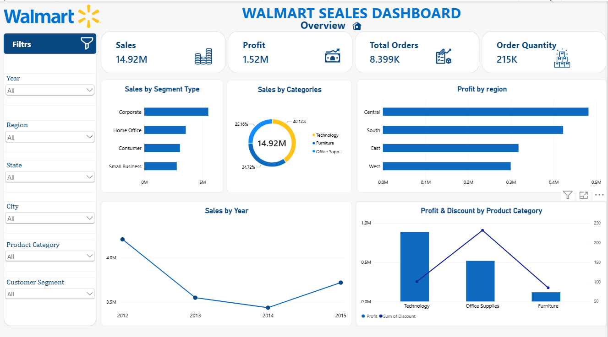
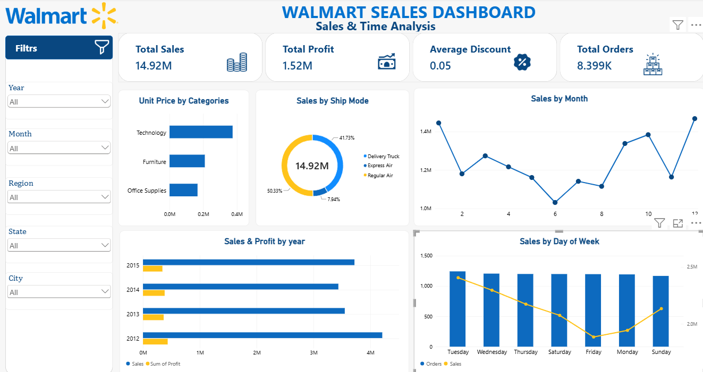
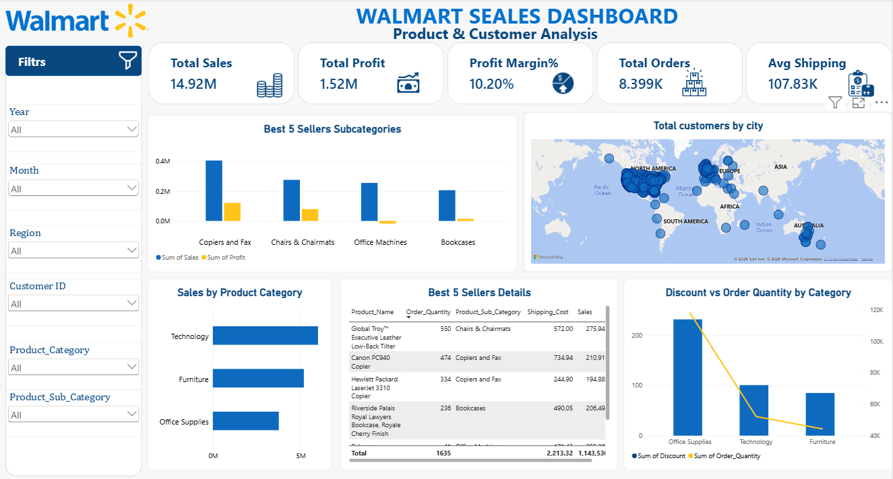
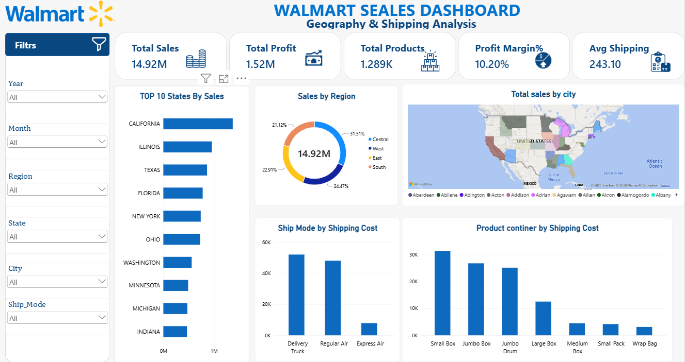

# 🛒 Walmart Sales Data Warehouse & BI Analytics (2012–2015)

An end-to-end **Data Warehousing, SQL Analytics, and Business Intelligence** project built using Walmart retail data covering products, customers, regions, states, cities, shipping modes, product containers, and time periods (2012–2015).

The project transforms raw retail data into meaningful business insights through SQL-based analysis, report validation, and interactive Power BI dashboards.

---

## 🏗️ Project Architecture & Workflow

### 1. Database Initialization & Schema Design
- Initialized the SQL Server database environment.
- Designed and organized dimensional warehouse schemas.
- Structured data related to sales, customers, products, shipping, and geographic locations.

### 2. Data Preparation & SQL Business Analysis
- Prepared and organized raw source data.
- Performed SQL-based business analysis.
- Analyzed revenue trends, profit margins, discounting patterns, and product performance.
- Investigated regional and state-level performance.
- Evaluated shipping modes, product containers, and associated shipping costs.

### 3. Reporting, Validation & Power BI Development
- Validated analytical metrics against SQL query results.
- Developed a four-page interactive Power BI dashboard.
- Implemented dynamic slicers for multi-dimensional analysis.

---

## 📊 Key Business Metrics (KPIs)

| Metric | Value |
|---|---:|
| 💰 Total Sales | **$14.92M** |
| 📈 Total Profit | **$1.52M** |
| 📊 Overall Profit Margin | **10.20%** |
| 🛒 Total Orders | **8.399K** |
| 📦 Total Order Quantity | **215K Units** |
| 🏷️ Total Products | **1.289K** |
| 📉 Average Discount | **5%** |
| 🚚 Average Shipping Cost | **107.83K** |

---

## 📈 Power BI Dashboard & Business Insights

The dashboard consists of four interactive pages, providing a comprehensive view of Walmart's sales performance, product profitability, customer behavior, geographic distribution, and shipping operations.

### 1. Executive Overview



**Key Insights:**

- **Category Performance:** Technology leads total revenue, contributing **40.12%** of sales, followed by Furniture (**34.72%**) and Office Supplies (**25.16%**).
- **Customer Segments:** Corporate customers generate the highest revenue among customer segments.
- **Regional Profitability:** Central is the most profitable region, generating approximately **$0.48M** in profit.
- **Discount vs. Profit:** Office Supplies records the highest cumulative discount volume, while Technology achieves stronger profitability with lower discounting.

---

### 2. Sales & Time Analysis



**Key Insights:**

- **Yearly Sales Trend:** Sales exceeded **$4.2M** in 2012, declined during 2013–2014, and recovered to approximately **$3.7M** in 2015.
- **Monthly Seasonality:** December and January record the highest sales, reaching approximately **$1.47M** and **$1.44M**, respectively. June records the lowest sales at approximately **$1.03M**.
- **Day-of-Week Performance:** Tuesday records the highest sales and order volume, while Friday shows the lowest sales value despite relatively steady order counts.
- **Shipping Mode Distribution:**
  - Regular Air: **50.33%**
  - Delivery Truck: **41.73%**
  - Express Air: **7.94%**

---

### 3. Product & Customer Analysis



**Key Insights:**

- **Top Subcategories:** Copiers and Fax leads both sales (approximately **$0.41M**) and profit (approximately **$0.12M**), followed by Chairs & Chairmats.
- **Profitability Analysis:** Office Machines generates approximately **$0.26M** in sales but records a slight net loss.
- **Top-Selling Products:**
  - Global Troy™ Executive Leather Low-Back Tilter – **550 units**.
  - Canon PC940 Copier – **474 units**.
  - Hewlett Packard LaserJet 3310 Copier – **334 units**.
- **Geographic Customer Distribution:** Customers are distributed across North America, Europe, Australia, South America, Africa, and Asia, with the strongest concentration in North America and Europe.

---

### 4. Geography & Shipping Analysis



**Key Insights:**

- **Top 10 States by Sales:** California leads in sales, followed by Illinois, Texas, Florida, New York, Ohio, Washington, Minnesota, Michigan, and Indiana.
- **Sales by Region:** Central contributes the largest share of total sales (**31.51%**), followed by:
  - West: **24.47%**
  - East: **22.91%**
  - South: **21.12%**
- **Shipping Mode Analysis:** Delivery Truck and Regular Air incur the highest shipping costs, ranging approximately between **$48K and $52K**, while Express Air costs less than **$10K**.
- **Product Container Analysis:** Small Box (~**$31K**), Jumbo Box (~**$27K**), and Jumbo Drum (~**$25K**) account for the highest shipping costs among product container types.

---

## 🎛️ Dashboard Features & Interactive Filters

The dashboard provides dynamic filtering capabilities through:

- Year
- Month
- Region
- State
- City
- Product Category
- Customer Segment
- Product Subcategory
- Customer ID
- Shipping Mode

These interactive filters allow users to explore business performance across different dimensions and investigate specific trends.

---

## 📂 Project Structure

```text
walmart project/
│
├── analytics/
│   ├── business analysis/
│   └── Reports/
│
├── raw data/
│
├── schemas/
│
├── images/
│   ├── overview.png
│   ├── sales_time.png
│   ├── product_customer.png
│   └── geography_shipping.png
│
├── init database
├── Reports Validations
│
└── README.md
```

---

## 🛠️ Tools & Technologies

| Technology | Usage |
|---|---|
| SQL Server | Database management and warehouse implementation |
| SQL | Data analysis, business queries, KPI calculations, and report validation |
| Power BI | Interactive dashboards, data visualization, and business reporting |

---

## 🎯 Project Objectives

- Evaluate overall sales performance and profitability.
- Identify top-performing products and subcategories.
- Understand customer segment behavior.
- Analyze regional and state-level sales distribution.
- Discover sales trends and seasonal patterns.
- Investigate the relationship between discounts and profitability.
- Evaluate shipping methods and product container costs.
- Transform business data into actionable insights through interactive reporting.

---

## 👩‍💻 Author

**Alaa Yasser**

Computer Science Student | Artificial Intelligence

Interested in Data Analytics, Business Intelligence, Data Warehousing, Machine Learning, and AI Applications.